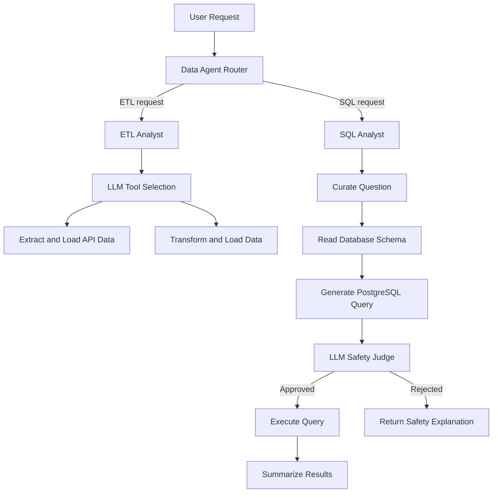

# AI-Powered Data Analyst Agent

An AI-powered data assistant that routes natural-language requests to specialized agents for **ETL (Extract, Transform, Load)** workflows and **SQL-based data analysis**. Built with LangGraph, LangChain, Groq models, Pandas, and PostgreSQL.

## Overview

The project uses a router agent to identify the type of task requested by the user and direct it to the appropriate workflow:

- **ETL Analyst** — extracts data from an API, saves it in a selected format, and supports data-transformation requests using Pandas.
- **SQL Analyst** — converts a natural-language question into a PostgreSQL query, evaluates the query with an LLM-based safety judge, executes approved queries, and summarizes the results.
- **Data Agent Router** — classifies a request as either an ETL or SQL task and invokes the corresponding agent graph.

## Architecture



## Features

### 1. Intelligent task routing
- Classifies incoming requests as `etl` or `sql`.
- Uses a structured LLM output schema for routing.
- Runs the selected workflow through a LangGraph state graph.

### 2. ETL workflow
- Extracts JSON data from an API endpoint.
- Normalizes JSON into a Pandas DataFrame.
- Supports saving extracted data as CSV, JSON Lines, or Parquet.
- Provides an LLM-driven transformation workflow based on a user's request and a sample of the source data.
- Uses LangChain tools for ETL operations.

### 3. SQL analysis workflow
- Rewrites questions into clearer, more precise requests.
- Retrieves PostgreSQL table and column metadata to provide schema context.
- Generates read-only SQL queries with a default `LIMIT 10` instruction.
- Uses a structured LLM judge to assess whether a generated query appears safe.
- Executes approved queries and turns the results into a concise natural-language answer.

### 4. Model selection
Selects a Groq-hosted model according to the configured reasoning level:
- `low` — `openai/gpt-oss-20b`
- `medium` — `openai/gpt-oss-120b`
- `high` — `llama-3.3-70b-versatile`

Model availability depends on your Groq account and provider configuration.

## Tech Stack

| Component | Technology |
|---|---|
| Language | Python |
| Agent orchestration | LangGraph |
| LLM framework and tools | LangChain |
| LLM provider | Groq |
| Data transformation | Pandas |
| API requests | Requests |
| Database | PostgreSQL |
| PostgreSQL driver | Psycopg2 |
| Configuration | python-dotenv |
| Data validation and state schemas | Pydantic |

## Project Structure

The following is a suggested layout based on the modules in this project. Adjust it to match your repository.

```text
.
├── agents/
│   ├── data_agent.py
│   ├── etl_analyst.py
│   └── sql_analyst.py
├── models/
│   └── schema.py
├── utils/
│   ├── database.py
│   ├── etl_tools.py
│   └── llm_pick.py
├── data/
│   ├── extract/
│   └── transform/
├── .env
├── .gitignore
├── requirements.txt
└── README.md
```

## Getting Started

### Prerequisites

- Python 3.10 or newer (use a version compatible with your installed LangChain packages).
- A Groq API key.
- PostgreSQL, if you want to use the SQL Analyst.
- Git.

### 1. Clone the repository

```bash
git clone <YOUR_GITHUB_REPOSITORY_URL>
cd <YOUR_PROJECT_DIRECTORY>
```

### 2. Create and activate a virtual environment

**Windows (PowerShell)**

```powershell
python -m venv .venv
.venv\Scripts\Activate.ps1
```

**macOS / Linux**

```bash
python3 -m venv .venv
source .venv/bin/activate
```

### 3. Install dependencies

Create a `requirements.txt` containing the packages used by the project, then run:

```bash
pip install -r requirements.txt
```

The project imports these packages directly or uses them in its workflows:

```text
langchain
langchain-core
langgraph
langchain-groq
python-dotenv
requests
pandas
psycopg2-binary
pydantic
pyarrow
ipython
```

Install `pyarrow` if you want Parquet support. `ipython` is used by the optional graph-visualization code. Verify package compatibility in your environment and pin versions once the project is stable.

### 4. Configure environment variables

Create a `.env` file in the project root:

```env
GROQ_API_KEY=your_groq_api_key

host=localhost
port=5432
user=postgres
password=your_postgres_password
database=your_database_name
```

- `GROQ_API_KEY` is required for the Groq chat models.
- The database variables are read by the PostgreSQL utility.
- PostgreSQL must be running and the configured database must be accessible when using the SQL Analyst.

**Never commit your `.env` file or expose API keys and database passwords.**

### 5. Run the agent

Run the entry-point module from the project root, using the path that matches your repository:

```bash
python agents/data_agent.py
```

The example in the data-agent module sends an ETL request to the public Pokémon API and asks the agent to save the extracted data. Update the example or call the compiled graph from your own application to try other requests.

## Example Requests

### ETL: Extract data

```text
Extract data from https://pokeapi.co/api/v2/pokemon
and save it to data/extract in CSV format.
```

### ETL: Transform data

```text
Transform the extracted dataset, keep only the rows matching
my specified condition, and save the result in CSV format.
```

Provide an existing supported input file and a clear transformation requirement.

### SQL: Ask a database question

```text
What payment methods are available in my database?
```

The SQL workflow uses the connected PostgreSQL schema to generate and execute a query, then summarizes the returned rows.

## How It Works

1. **Route:** The Data Agent classifies the user's request as an ETL or SQL task.
2. **Plan and act:** The selected sub-agent uses its graph and tools to handle the request.
3. **Process data or query the database:** The ETL workflow handles API/file data; the SQL workflow uses database schema context to generate a query.
4. **Check the SQL query:** The SQL workflow asks an LLM-based judge to assess the generated SQL before execution.
5. **Respond:** The workflow returns an operation status or a natural-language summary of SQL results.

## Security Notes and Limitations

- **An LLM safety judgment is not a security boundary.** Do not run generated SQL against production data without independent validation and database permissions that enforce read-only access.
- The current SQL implementation relies on an LLM judge and does not replace a SQL parser, query allowlist, or database-level read-only transaction/role.
- The ETL transformation workflow executes LLM-generated Python code using `exec`. Executing generated code can run arbitrary Python and is unsafe for untrusted input. Use a sandbox or replace this approach with validated, allowlisted transformation operations before using the project with real data.
- Use API timeouts, validate input URLs and output paths, and handle API pagination and rate limits before relying on external APIs.
- Confirm that the configured database credentials have only the permissions the application needs.
- The implementation is a development project; test it against sample data before using it for important workloads.

## Roadmap

- [ ] Add automated tests for routing, ETL operations, and SQL generation.
- [ ] Add robust error handling and structured logging.
- [ ] Validate generated SQL with a parser and enforce read-only database permissions.
- [ ] Replace unrestricted generated-code execution with sandboxed or allowlisted transformations.
- [ ] Support API pagination, retries, and configurable request timeouts.
- [ ] Add a user interface and execution-history view.
- [ ] Add Docker support and deployment documentation.

## Contributing

Contributions and suggestions are welcome.

1. Fork the repository.
2. Create a feature branch.
3. Make and test your changes.
4. Open a pull request describing the change.

## License

Choose a license for your repository (for example, MIT) and add the corresponding `LICENSE` file before presenting the project as open source.
